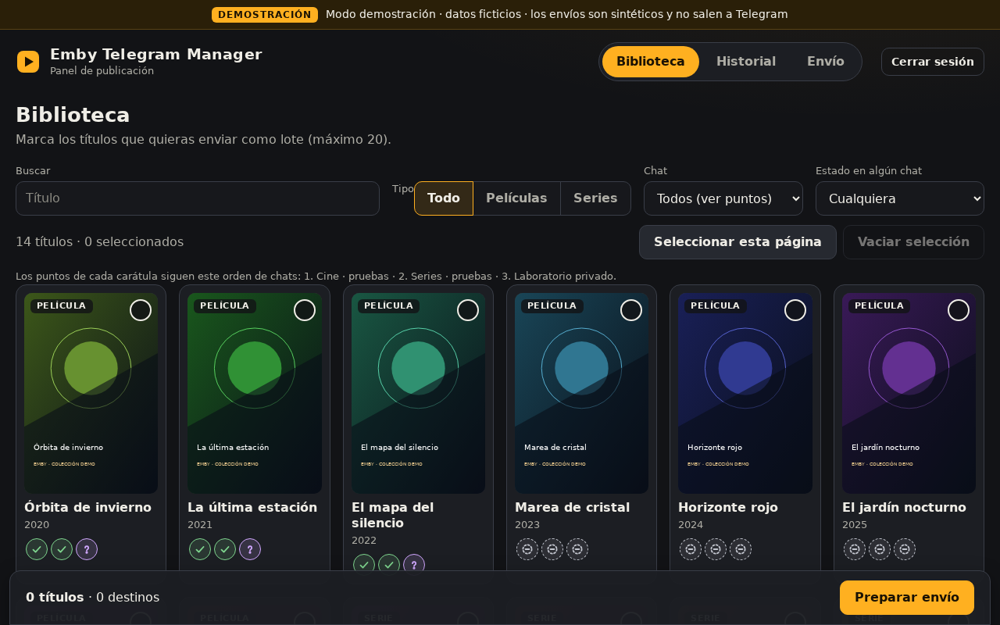
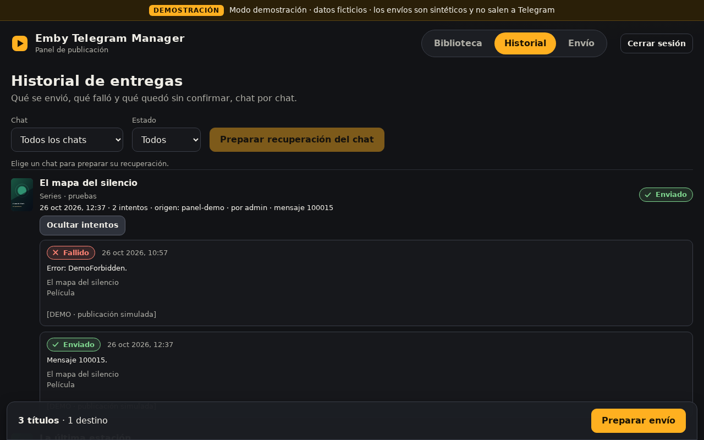
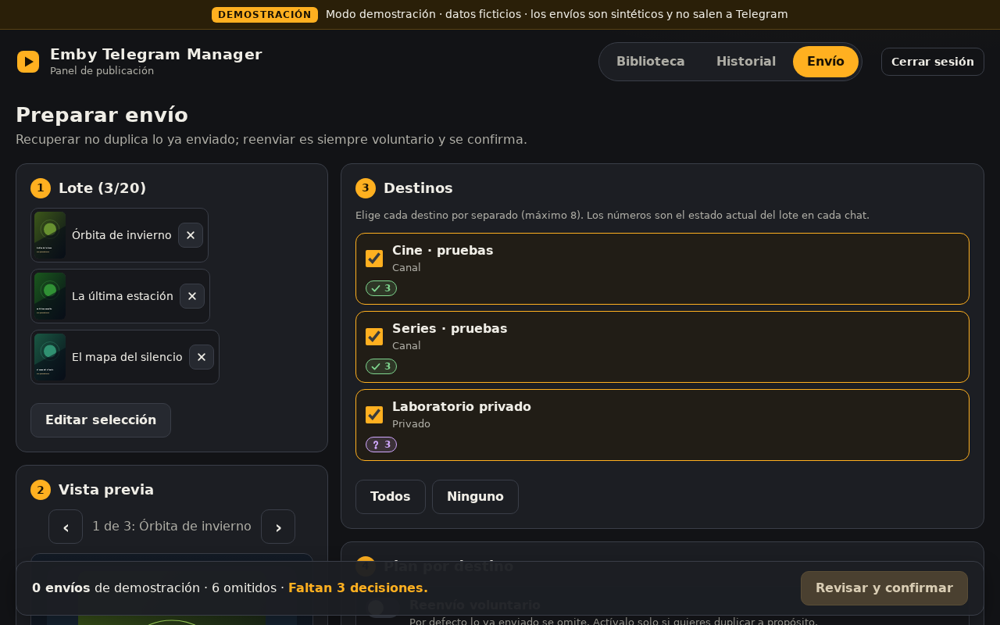
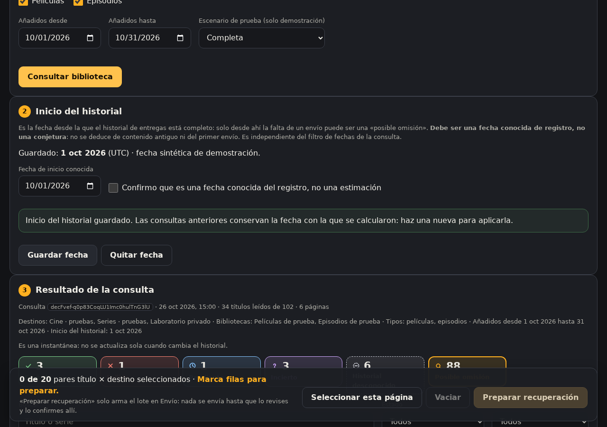
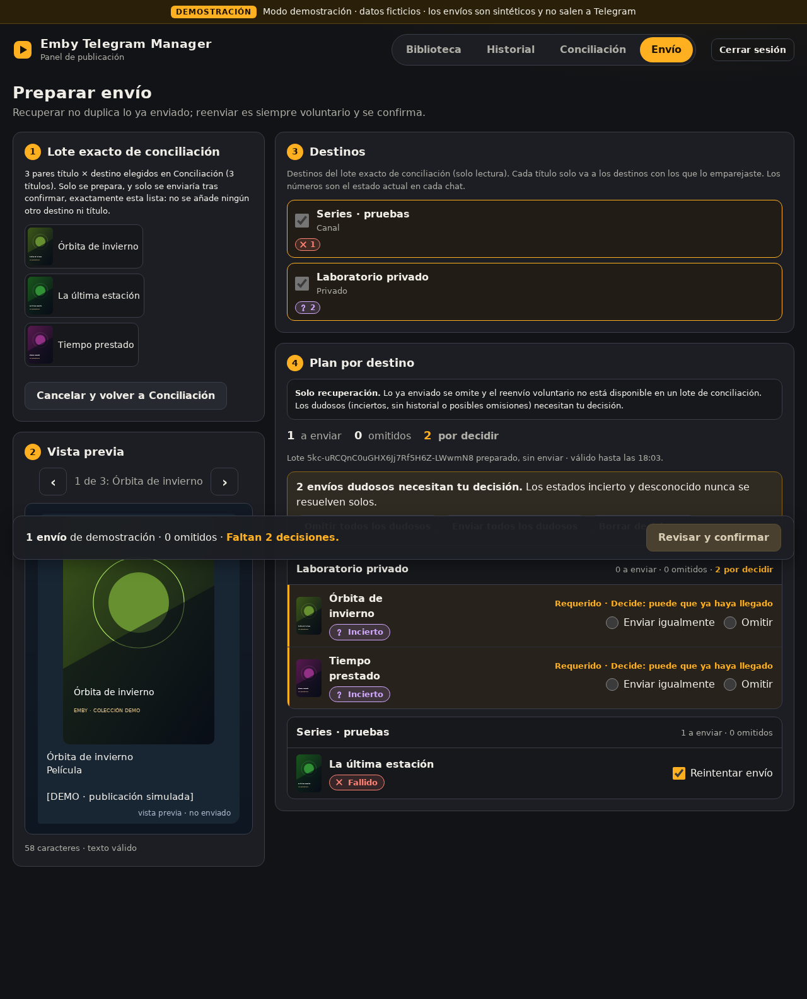

# emby-telegram-bot-v2

Servicio que conecta **Emby** con **Telegram**: recibe eventos de Emby por webhook, publica fichas de contenido nuevo en uno o varios chats, permite buscar y reenviar contenido desde Telegram y, desde EMBY-005, conserva un **historial persistente de entregas** con un **panel web opcional** para consultarlo, recuperar envíos y conciliar la biblioteca.

Licencia: MIT (ver `LICENSE`).

> **Estado de la rama `release/emby-005`.** Reúne el código de las fases EMBY-002, 003 y 004 sobre la base original. Los resultados de pruebas y la validación de Windows están resumidos en [`docs/RELEASE-NOTES.md`](docs/RELEASE-NOTES.md); **no equivalen a una validación operativa con un Emby y un Telegram reales ni a un despliegue en producción.**

## Qué hace

### Funcionalidades originales

- Notificación de **nuevas películas** y **nuevos episodios**, con ficha rica: carátula, sinopsis desplegable, valoraciones, calidad/formato deducidos de la metadata de Emby (`MediaSources`/`MediaStreams`) y enlace a IMDb cuando existe.
- **Agrupación de episodios** por temporada en una sola notificación (buffer temporal configurable).
- **Eventos de reproducción** (inicio, parada y, opcionalmente, pausa/reanudar), con estilo compacto o detallado.
- **Búsqueda desde Telegram** (`/buscar`) con filtro Todo / Películas / Series.
- **Reenvío manual** por administradores (`/reenviar`, `/reenviaultimo`, `/reenvia ID`) tras reidentificar contenido en Emby.
- Destinos separados para biblioteca y reproducción, etiquetas amigables de chat (`CHAT_LABELS`) y diagnóstico (`/diagnostico`).
- Secretos fuera del código (`.env`), escape seguro de MarkdownV2 y validación opcional del webhook de Telegram.

### Añadido en las fases 002, 003 y 004

| Fase | Aporte |
|---|---|
| **EMBY-002** · Historial de entregas | Registro persistente en SQLite de cada publicación (por contenido, destino e intento). Estados `enviado`, `fallido`, `pendiente`, `incierto` e «historial desconocido». Comandos `/historial` y `/reintentar`. |
| **EMBY-003** · Panel web | Panel «Emby Telegram Manager» con Biblioteca, Historial y Envío: selección por lotes, vista previa, plan por destino y confirmación explícita. Modo demostración con datos ficticios. |
| **EMBY-004** · Conciliación | Pestaña Conciliación: compara la biblioteca de Emby con el historial, clasifica cada par contenido × destino y permite preparar la recuperación de un lote exacto. Solo lectura hasta que se confirma un envío. |

La fase EMBY-005 integra todo lo anterior en una única rama con instalación Docker y guía de migración.

## Panel web (capturas de la demostración)

Las capturas son de la **demostración local con datos ficticios**; en ellas no sale nada a Telegram.

| | |
|---|---|
|  |  |
| **Biblioteca**: selección de títulos y estado por chat. | **Historial**: entregas, intentos y errores por chat. |
|  |  |
| **Envío**: plan por destino; lo ya enviado se omite y lo dudoso exige decisión. | **Conciliación**: consulta de solo lectura e inicio conocido del historial. |



**Recuperación de un lote de conciliación**: solo se envía lo elegido, tras revisar y confirmar.

## Garantías de diseño

- **Sin envíos sin confirmación.** El panel prepara un plan (válido 15 minutos) y solo ejecuta tras confirmar; los envíos manuales se pueden desactivar con `PANEL_ALLOW_SENDS=false` (valor por defecto).
- **Lo ya enviado no se duplica.** Al recuperar, los pares con envío confirmado se omiten.
- **Lo incierto nunca se resuelve solo.** Un intento sin confirmación fiable (`incierto`) o sin historial exige una decisión explícita («Enviar igualmente» / «Omitir»).
- **La conciliación no presume omisiones.** Solo marca «posible omisión» dentro del período registrado y con lectura completa; si la lectura de Emby es incompleta, el resultado es «historial desconocido».

Detalle completo en [`docs/USAGE.md`](docs/USAGE.md).

## Inicio rápido

### Docker (servicio real)

```bash
cp .env.example .env     # rellena TELEGRAM_TOKEN, CHAT_IDS, EMBY_API_URL y EMBY_API_KEY
docker compose --profile production up --build -d
curl -fsS http://localhost:8081/health   # {"status":"ok"}
```

El servicio `app` pertenece al perfil `production`: **sin `--profile production` no arranca**. Contenedor y volumen (`<proyecto>_history-data`) no tienen nombre fijo; Compose los deriva del directorio o de `COMPOSE_PROJECT_NAME`.

Copia de seguridad del historial (en caliente) y restauración (con el servicio parado, `docker compose stop app`):

```bash
scripts/backup.sh /ruta/segura
scripts/restore.sh /ruta/segura/history-AAAAMMDDTHHMMSSZ-XXXXXX.sqlite3
```

Guía completa (credenciales, panel opcional, persistencia, copias de seguridad, actualización): [`docs/INSTALLATION.md`](docs/INSTALLATION.md). Guía paso a paso para principiantes: [`docs/DEPLOYMENT_STEP_BY_STEP.md`](docs/DEPLOYMENT_STEP_BY_STEP.md).

### Demostración local del panel (sin Telegram ni Emby)

Linux/macOS (Python 3.11+, con las dependencias de `requirements.txt` instaladas):

```bash
python3 -m venv .venv && .venv/bin/pip install -r requirements.txt
sh scripts/run_demo.sh
```

Windows: ejecuta `INICIAR-WINDOWS.bat` (crea `.venv` e instala dependencias la primera vez).

Abre <http://127.0.0.1:8093/manager/>. La contraseña de demostración es `emby-demo-003`. La demostración usa datos ficticios, una base SQLite propia (`data/emby004-demo.sqlite3`) y **bloquea las conexiones salientes**; no carga `.env`. Puedes cambiar `HOST` y `PASEO_PORT` con variables de entorno (`scripts/run_demo.sh`) o `--host/--port` (`scripts/run_manager.py`). El perfil `demo` de Docker Compose se describe en la sección 9 de [`docs/INSTALLATION.md`](docs/INSTALLATION.md).

## Migración desde una versión anterior

[`docs/MIGRATION.md`](docs/MIGRATION.md) explica cómo conservar el historial y volver atrás.

## Comandos de Telegram (resumen)

| Comando | Quién | Qué hace |
|---|---|---|
| `/buscar [título]` | Todos | Busca películas y series |
| `/menu`, `/start`, `/help` | Todos | Menú y ayuda |
| `/reenviar`, `/reenviaultimo` (`/lastadded`), `/reenvia ID` | Admin, en privado | Reenvío manual con selector de destino |
| `/historial [página] [estado]`, `/historial item ID` | Admin, en privado | Consulta del historial de entregas |
| `/reintentar NÚMERO [confirmar-incierto]` | Admin, en privado | Reintenta una entrega concreta |
| `/diagnostico` (`/estado`, `/diagnostico_playback`) | Chats autorizados | Valida configuración, Emby y Telegram |
| `/version`, `/reload_menu` | Admin, en privado | Versión desplegada y recarga del menú |

Detalle, ejemplos y reglas en [`docs/USAGE.md`](docs/USAGE.md).

## Configuración

Ejemplo completo en `.env.example`. Variables principales:

| Variable | Descripción |
|---|---|
| `TELEGRAM_TOKEN` | Token de BotFather (obligatoria) |
| `CHAT_IDS` | Chats de destino separados por coma (obligatoria) |
| `ADMIN_CHAT_IDS` | IDs privados con permisos de administración. Los comandos `/historial` y `/reintentar` **no** recurren a `CHAT_IDS` si está vacía |
| `LIBRARY_CHAT_IDS`, `PLAYBACK_CHAT_IDS` | Destinos específicos de biblioteca y reproducción (si están vacíos, `CHAT_IDS`) |
| `CHAT_LABELS` | Nombres amigables, p. ej. `chat:Canal novedades,-100123:Grupo familia` |
| `EMBY_API_URL`, `EMBY_API_KEY` | Acceso a Emby (obligatoria la clave) |
| `REQUEST_TIMEOUT_SECONDS`, `EPISODE_BUFFER_SECONDS` | Tiempos de espera y de agrupación (> 0) |
| `LIBRARY_DEBOUNCE_SECONDS`, `PLAYBACK_DEBOUNCE_SECONDS` | Ventanas anti-duplicado (≥ 0) |
| `ENABLE_LIBRARY_NOTIFICATIONS`, `ENABLE_PLAYBACK_NOTIFICATIONS` | Activan cada tipo de notificación |
| `PLAYBACK_NOTIFY_PAUSE`, `PLAYBACK_WITH_IMAGE`, `PLAYBACK_STYLE` | Ajustes de reproducción (`compact`/`detailed`) |
| `APP_TIMEZONE`, `APP_VERSION` | Zona horaria IANA y etiqueta de build mostrada por `/version` |
| `TELEGRAM_WEBHOOK_SECRET` | Secreto opcional del webhook de Telegram |
| `HISTORY_DB_PATH` | Fichero SQLite persistente del historial (por defecto `data/history.sqlite3`; no admite `:memory:`) |
| `PANEL_ENABLED`, `PANEL_ADMIN_PASSWORD`, `PANEL_SECRET_KEY`, `PANEL_ALLOW_SENDS` | Panel web opcional (desactivado por defecto) |

Reglas del panel operativo: `PANEL_ENABLED=false` por defecto; si se activa exige `PANEL_ADMIN_PASSWORD` de al menos 16 caracteres y `PANEL_SECRET_KEY` de al menos 32, ninguno con valores de demostración o marcador; `PANEL_ALLOW_SENDS=false` por defecto y solo afecta a los envíos manuales del panel, no a los webhooks del bot. La cookie de sesión es siempre `Secure`, por lo que el panel exige HTTPS. Ver [`docs/INSTALLATION.md`](docs/INSTALLATION.md) y [`docs/SECURITY.md`](docs/SECURITY.md).

## Opcional bloqueado: Gemini

La delegación a Gemini quedó **bloqueada por limitaciones técnicas del entorno** (no se pudo verificar el aislamiento de archivos y red) y **no forma parte de este proyecto ni es necesaria para usarlo**. Detalle en [`docs/GEMINI-STATUS.md`](docs/GEMINI-STATUS.md).

## Pruebas

```bash
python -m pytest -q -p no:cacheprovider
```

Las pruebas de navegador (`tests/panel-browser.cjs`, `tests/reconciliation-browser.cjs`) usan Chromium y están descritas en [`CONTRIBUTING.md`](CONTRIBUTING.md).

## Estructura del proyecto

- `src/emby_telegram_bot/config.py`: carga y validación de entorno.
- `src/emby_telegram_bot/emby_client.py`: cliente de Emby.
- `src/emby_telegram_bot/telegram_client.py`: envío a Telegram y menús de comandos.
- `src/emby_telegram_bot/formatting.py`: fichas, captions y specs.
- `src/emby_telegram_bot/episode_aggregator.py`: agrupado de episodios.
- `src/emby_telegram_bot/deliveries.py`: historial persistente (SQLite) de entregas e intentos.
- `src/emby_telegram_bot/publications.py`: casos de uso de publicación y reintento.
- `src/emby_telegram_bot/reconciliation.py`: conciliación de solo lectura.
- `src/emby_telegram_bot/web_manager.py` y `panel_static/`: API y interfaz del panel.
- `src/emby_telegram_bot/demo.py`: aplicación de demostración con datos ficticios.
- `src/emby_telegram_bot/webhook.py`: endpoints Flask (`/health`, `/embyhook`, `/telegramhook`) y comandos.
- `src/emby_telegram_bot/wsgi.py` y `main.py`: puntos de entrada.
- `scripts/`: arranque de la demostración (`run_demo.sh`, `run_manager.py`) y copia de seguridad del historial (`backup.sh`, `restore.sh` y su ayudante `sqlite_volume.py`).

## Documentación

| Documento | Contenido |
|---|---|
| [`docs/USAGE.md`](docs/USAGE.md) | Uso: comandos, panel, conciliación, webhook de Telegram y diagnóstico |
| [`docs/INSTALLATION.md`](docs/INSTALLATION.md) | Instalación con Docker Compose |
| [`docs/MIGRATION.md`](docs/MIGRATION.md) | Migración desde versiones anteriores |
| [`docs/SECURITY.md`](docs/SECURITY.md) | Seguridad y endurecimiento |
| [`docs/DEPLOYMENT_STEP_BY_STEP.md`](docs/DEPLOYMENT_STEP_BY_STEP.md) | Guía paso a paso |
| [`docs/RELEASE-NOTES.md`](docs/RELEASE-NOTES.md) | Notas de la versión y estado de verificación |
| [`CHANGELOG.md`](CHANGELOG.md) | Historial de cambios |
| [`CONTRIBUTING.md`](CONTRIBUTING.md) | Guía para contribuir |
| [`docs/GEMINI-STATUS.md`](docs/GEMINI-STATUS.md) | Delegación a Gemini bloqueada |
